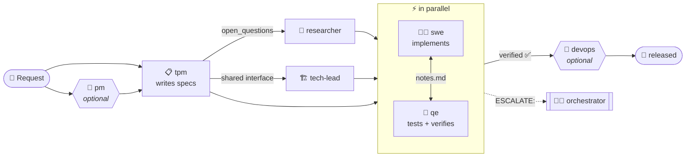

<div align="center">

# 🧑‍💼🤖 eng-team-orchestrator

<a href="https://github.com/j2jun/eng-team-orchestrator">
  
</a>

[](https://github.com/j2jun/eng-team-orchestrator/actions/workflows/test.yml)


</div>

A hybrid multi-agent orchestrator that models a small engineering team as Claude Agent SDK
subagents (TPM, Researcher, Tech Lead, SWE, QE, plus optional PM and DevOps), coordinated
by a top-level orchestrator.

> [!TIP]
> **Hybrid** = 🏛️ hierarchical dispatch (the orchestrator assigns tickets) + 🤝 peer
> channels (agents hand work to each other through shared files, and only bubble up to the
> orchestrator when something needs a cross-workstream decision).

## 🗺️ How a request flows



## 🗂️ The task graph is just files

No message bus. Each run gets its own folder in the target repo,
`tickets/<RUN-ID>/<TICKET-ID>/`, so old tickets never affect a new run:

| File | What's in it |
|---|---|
| 📄 `spec.json` | ticket, title, acceptance_criteria, owner_module, open_questions, status |
| 📝 `notes.md` | running log every role reads and writes; peer handoffs (SWE ↔ QE, SWE ↔ Researcher) happen here |

**Escalations** 🚨: a line starting with `ESCALATE:` gets one orchestrator turn to resolve.
The orchestrator rewrites it to `RESOLVED: <decision>`. If it's still open after that, the
run stops and prints it for you.

**Done** 🏁: every ticket is `verified`, or `released` / `no-release` when devops is enabled.

## 👥 Roles

| | Agent | Engages when |
|---|---|---|
| 🧭 | **pm** *(opt-in)* | Request is open-ended about *what/why*; skipped for already-scoped tickets |
| 📋 | **tpm** | Always (after pm, if pm ran); turns intent into non-overlapping tickets |
| 🔬 | **researcher** | A ticket's spec has `open_questions` |
| 🏗️ | **tech-lead** | Multiple tickets share an interface or their boundaries could collide |
| 👩‍💻 | **swe** | Ticket is unblocked; implements inside its `owner_module` only |
| 🧪 | **qe** | *Same time* as swe, not after; drafts tests from the spec, then verifies the diff |
| 🚀 | **devops** *(opt-in)* | Ticket is `verified`; picks the release strategy, ships, owns rollback |

Role prompts live in [`agents/`](agents/). The full routing and escalation contract for the
top-level session is [`agents/orchestrator.md`](agents/orchestrator.md).

## 🚀 Quick start

```bash
pip install claude-agent-sdk
python setup.py                                   # 🛠️ one-time team setup
python orchestrator.py "add rate limiting to the /login endpoint"
```

> [!NOTE]
> It uses the `claude` CLI login you already have, so no separate API key is needed. Runs
> count against that account's usage.

<details>
<summary>🛠️ <b>What <code>setup.py</code> configures</b></summary>

<br/>

It writes `team.config.json` (gitignored, since it's per user and per machine):

- ✅ which optional roles are on (pm and devops are off by default)
- 🧠 the model for each role, plus `orchestrator_model` for the top-level session
- 🔢 how many tickets each role can run at once
- 🎯 the target repo (stored as an absolute path; it can't be this orchestrator repo)
- 📜 an optional house-rules file appended to every role's prompt
- 💸 `max_budget_usd` for a run, and how many nudge turns the orchestrator gets
- 📦 whether Bash runs in the OS sandbox

Re-run it any time; it pre-fills your current values.

</details>

### 🎯 Skip routing: run one role directly

If you already know which role should handle something:

```bash
python orchestrator.py --agent swe "fix the off-by-one in the rate limiter window"
python orchestrator.py --agent qe  "write a test plan for tickets/RATE-LIMIT-1"
```

That role works the request itself. No dispatch, no routing.

### 🙋 When the team needs you

There's no live user in a session. PM/TPM write `ESCALATE: need user input: <question>` to
`tickets/<RUN-ID>/QUESTIONS/notes.md`, and the run stops immediately and prints it. Answer
by re-running with a clearer request.

## 🛡️ Safety

| | Guard | How |
|---|---|---|
| 🔒 | No blanket permissions | `dontAsk` mode: anything not pre-approved is denied |
| 🧰 | Tools per role | Subagents get only their role's tools. A hook stops the orchestrator itself from using anything beyond Agent/Read/Write/Glob/Grep |
| 📁 | File writes | Write/Edit are approved only inside the target repo |
| 📦 | Bash sandbox | On by default: writes stay in the target repo (and temp dirs), network is blocked |
| 🧹 | Isolated sessions | Your personal Claude Code hooks, plugins, agents, MCP servers and skills are not loaded |
| 🚦 | Gated dispatch | A hook allows only roles on this run's team, at most `concurrency[role]` at once, always in the foreground |
| 💸 | Budget cap | `max_budget_usd` (default $10) stops a run |

> [!WARNING]
> - The budget is checked *between* API calls, so one expensive call can overshoot it.
> - Devops deploy commands usually need network access, so set `sandbox: false` when devops ships.
> - Without session isolation, your own setup gets sent on every call. In testing that was
>   ~1.2M tokens and ~$5 for a single orchestrator turn.

## 🧪 Self-check

```bash
python test_orchestrator.py
```

CI runs this on every push and PR. It never calls the Claude API.

## 📌 Status

<details>
<summary>🧠 <b>Routing and the nudge loop</b></summary>

<br/>

Routing is left to the top-level model's judgment per `agents/orchestrator.md`, not
hand-coded in Python. Swap in deterministic Python routing if you need it more predictable.

Subagent dispatch blocks until the agent finishes. It only runs in the background if the
model asks for `run_in_background`, and the dispatch hook turns that off. The nudge loop
(`max_turns` in config) moves the routing contract from one step to the next and is a safety
net, not a wait on async agents.

</details>

> [!CAUTION]
> **Known limitation:** parallel SWEs share one working tree. `owner_module` keeps them out of
> each other's files, but only by prompt, and concurrent test runs can collide. Per-ticket git
> worktrees would fix this, but that needs a merge step the orchestrator doesn't have yet.
